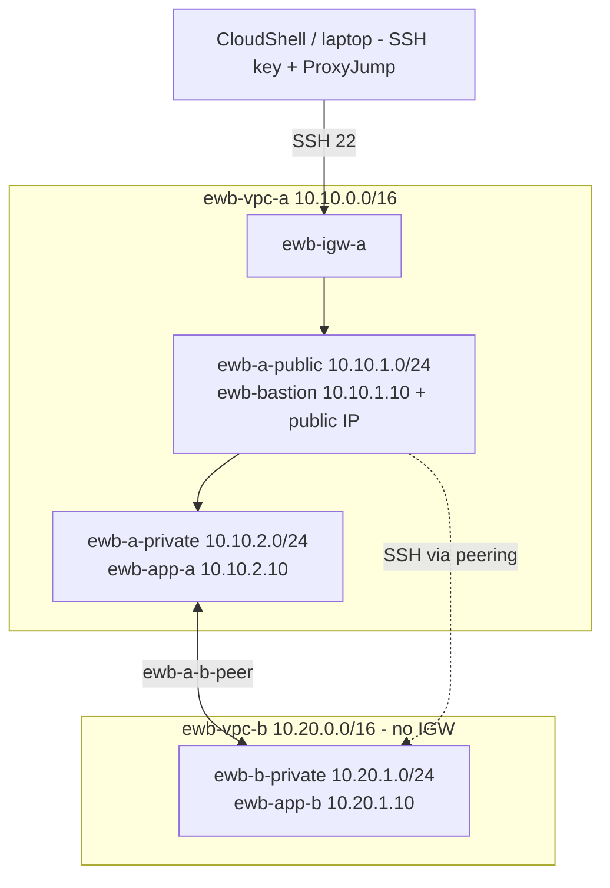

# AWS VPC Peering: Private Connectivity Between Two VPCs

**Student:** Saurav Mani Tripathi | **Batch:** `<your batch>` | **Region:** ap-southeast-2 (Sydney) | **Course:** EWB Courses, AWS Architect Associate, Project 01
**Repo:** https://github.com/saurav010403/aws-vpc-peering-project

Two private VPCs connected with a VPC peering connection. Both app servers have no public IP. Administration goes through one public bastion host. Built in the AWS Console; SSH tests were run from AWS CloudShell using ProxyJump through the bastion.

## Architecture

## Resource inventory

| Resource | Name | CIDR / IP | ID |
|---|---|---|---|
| VPC A | ewb-vpc-a | 10.10.0.0/16 | vpc-0be661539d57a71ec |
| VPC B | ewb-vpc-b | 10.20.0.0/16 | vpc-0c003e02bbe62d0b6 |
| Public subnet | ewb-a-public | 10.10.1.0/24 | subnet-0d638efd5a97cd8a6 |
| Private subnet A | ewb-a-private | 10.10.2.0/24 | subnet-04a99c31471b7e86c |
| Private subnet B | ewb-b-private | 10.20.1.0/24 | subnet-0ab3c36385c56632d |
| Internet gateway | ewb-igw-a | attached to VPC A | igw-00251b2d... |
| Route table | ewb-rt-a-public | | rtb-0d1c8bd5c7630a615 |
| Route table | ewb-rt-a-private | | rtb-034a80bb35156d917 |
| Route table | ewb-rt-b-private | | rtb-0d8e5ec2c33e4cfdd |
| Security group | ewb-sg-bastion | | sg-08f9e053c658169ad |
| Security group | ewb-sg-app-a | | sg-094238fbead58d9fb |
| Security group | ewb-sg-app-b | | sg-095f9aa845ae2055c |
| Peering | ewb-a-b-peer | A <-> B | pcx-03bc41f123c795628 |
| Bastion | ewb-bastion | 10.10.1.10 + public IPv4 | i-0b06740b5c2d5efc4 |
| App-A | ewb-app-a | 10.10.2.10 (no public IP) | i-0eae93a3e71c3a2d2 |
| App-B | ewb-app-b | 10.20.1.10 (no public IP) | i-0be720498d66e1ac0 |

## Routing and security rules
See `docs/architecture.md` for the final route tables and security group rules.

## Test results

| # | Test | Expected | Actual | Evidence |
|---|---|---|---|---|
| 1 | Baseline: App-A pings 10.20.1.10 before peering | No replies | 4 sent, 0 received, 100% loss | `12-baseline-ping-fail.png` |
| 2 | Forward: App-A pings 10.20.1.10 | 4/4, 0% loss | 4 sent, 4 received, 0% loss | `17-forward-ping.png` |
| 3 | Reverse: App-B pings 10.10.2.10 | 4/4, 0% loss | 4 sent, 4 received, 0% loss | `18-reverse-ping-and-ssh-app-b.png` |
| 4 | Private SSH to App-B via bastion | Shell on App-B | Logged in, hostname -I = 10.20.1.10 | `18-reverse-ping-and-ssh-app-b.png` |
| 5 | No public IPv4 on App-A / App-B | Empty | Public IPv4 = "-" on both | `21-`, `22-isolation-*.png` |
| 6 | Controlled failure: remove ICMP rule on App-B, then restore | Fail, then recover | 100% loss, then 0% loss | `19-controlled-failure-and-recovery.png` |

## Issues I hit (and fixed)
- Region: the lab account was limited to Sydney (ap-southeast-2), so everything was built there instead of Mumbai.
- Route table edit error: adding `10.20.0.0/16` to ewb-rt-b-private failed because that is VPC B's own CIDR. The destination must be the *other* VPC's CIDR (`10.10.0.0/16`).
- While adding the peering route to ewb-rt-a-public I overwrote an existing row twice (first the 0.0.0.0/0 igw route, then the peering route). Fixed by using **Add route** so the table ended with 3 routes.
- SSH timed out from CloudShell because its public IP differed from the IP allowed in ewb-sg-bastion. Fixed by allowing the current CloudShell IP /32.

## What I learned
`<write 3-5 lines in your own words>`

## Cleanup
All `ewb-*` resources were deleted: instances terminated, peering and routes removed, security groups, route tables, subnets, internet gateway and both VPCs deleted. See `evidence/screenshots/25-cleanup-instances-terminated.png` and the final cleanup screenshot.

> Never commit `.pem` keys. `.gitignore` already blocks them.
